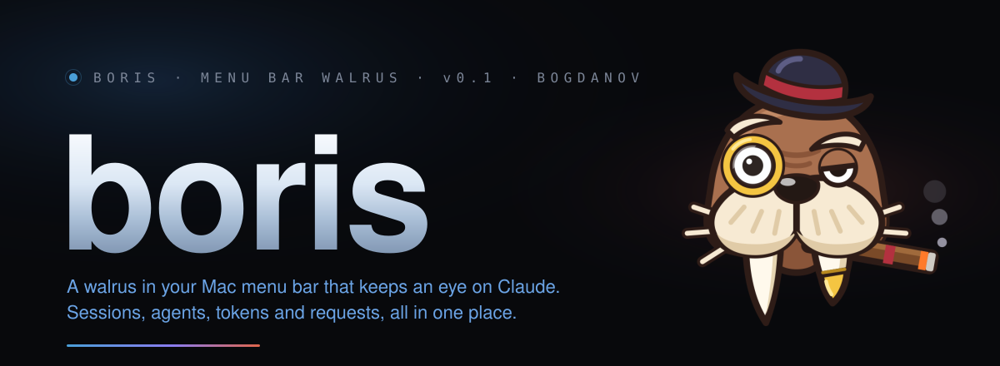
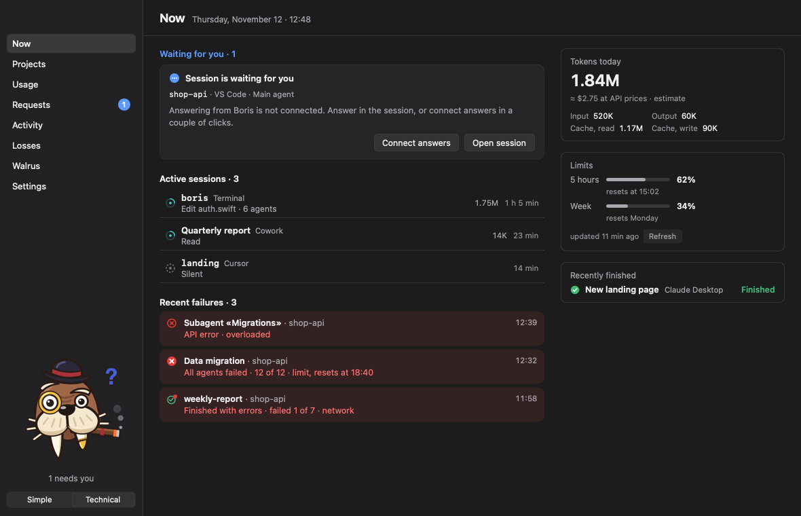
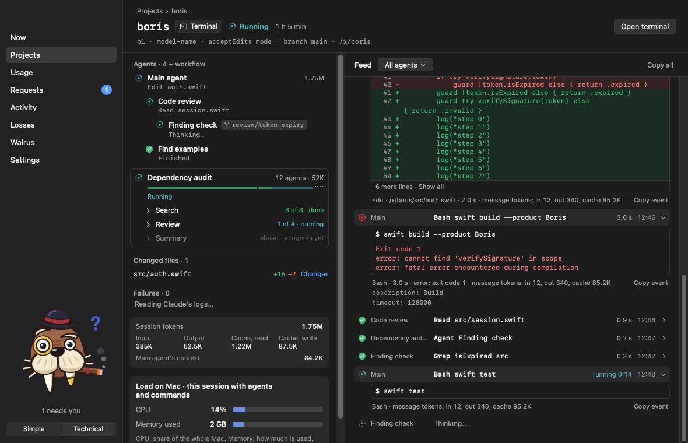
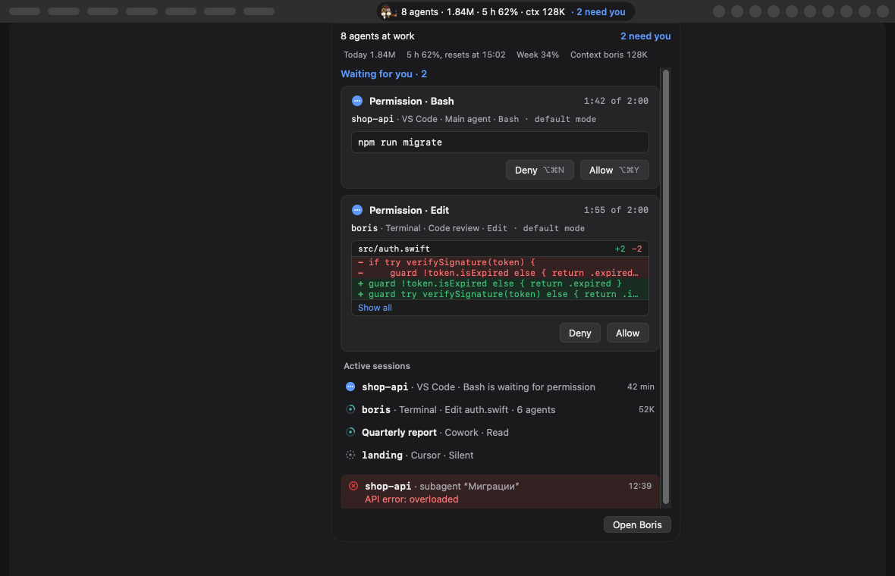
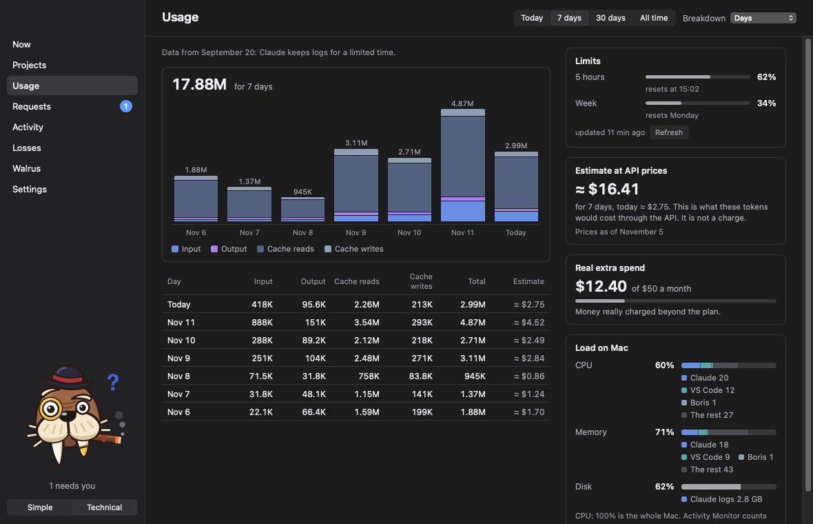
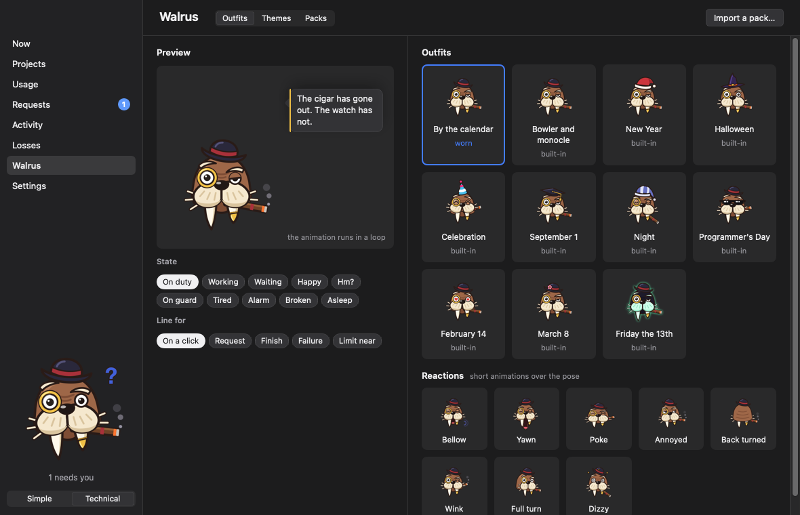

<p align="center">
  
</p>

<p align="center">
  
  
  
  
  
  
</p>

<p align="center">
  <b>English</b> · <a href="README.ru.md">Русский</a>
</p>

---

Boris is a small Mac app for people who run Claude in more than one place at a time.

One session runs in the terminal, another in VS Code, a workflow with a dozen agents works somewhere in the background, and Cowork is putting a report together. Which of them are still going? What just broke? How much of the weekly limit is left? And who has been waiting ten minutes for you to click "Allow"?

Boris answers all of that at a glance. He lives in your menu bar, wears a bowler hat and a monocle, and stays quiet until something needs you.

<p align="center">
  
</p>

## What he does

**Sees everything that's running.** Claude Code in the terminal, VS Code, Cursor and the Desktop app, Cowork, and other machines over SSH. You get projects, sessions, every agent and subagent, workflows step by step, and what each of them is doing right now.

<p align="center">
  
</p>

**Lets you answer without switching windows.** Permissions, questions and plans arrive as cards. Allow, deny or send a reason straight from the menu bar, the notch or the mini window.

<p align="center">
  
</p>

**Counts the cost.** Tokens by day, project, model and agent. Your plan's 5-hour and weekly limits, and the extra spend you actually pay for. Plus how much CPU and memory Claude is taking.

<p align="center">
  
</p>

**Tells you why things failed.** A workflow says `completed`, but all twelve of its agents hit the usage limit? Boris says so, and tells you when the limit resets.

**Taps you on the shoulder when it matters.** A Mac notification, a sound or a Telegram message when a request is waiting or something has failed.

**Has two modes.** Simple, to see at a glance whether you're needed. Technical, for the full picture: feeds, diffs, commands and token breakdowns.

## Meet Boris

A walrus with a bowler hat, a monocle and a cigar. He's a bit of a Churchill: he delivers bad news with dignity, even when everything is on fire. He dresses for the occasion, with a Santa hat at New Year and a witch's hat at Halloween. Poke him and he reacts. And if you'd rather have someone else, swap him for your own character with a pack of pictures.

<p align="center">
  
</p>

## Install

There are no ready-made releases yet, so Boris is built from source. You need macOS 14 or later and Xcode with Swift 6.

```sh
git clone https://github.com/bogdanov-igor/boris.git
cd boris
scripts/install.sh
```

The script builds the app, puts it in `~/Applications/Boris.app` and starts it. Run it again after `git pull` to update. Without an Apple developer certificate the build is signed ad hoc, so macOS may ask for permissions again after each build. Signed releases with automatic updates are coming.

## Hooks are optional

Out of the box, Boris only reads the files Claude already writes to disk, and that covers almost everything. Hooks add two things: answering requests from Boris, and hearing about events the moment they happen. You turn them on in Settings. Boris first shows exactly what will change in Claude's settings, and turning hooks off takes out only what Boris added.

## Your data stays on your Mac

No account and no server. Boris never sends your prompts, commands or code anywhere. It goes online only to refresh your plan limits, and to reach Telegram if you turn that on. It changes Claude's settings only when you connect hooks yourself.

## License

The code is under MIT. The walrus, his drawings, lines and sounds are not: see [LICENSE](LICENSE).

Boris is an independent project and is not affiliated with Anthropic.
