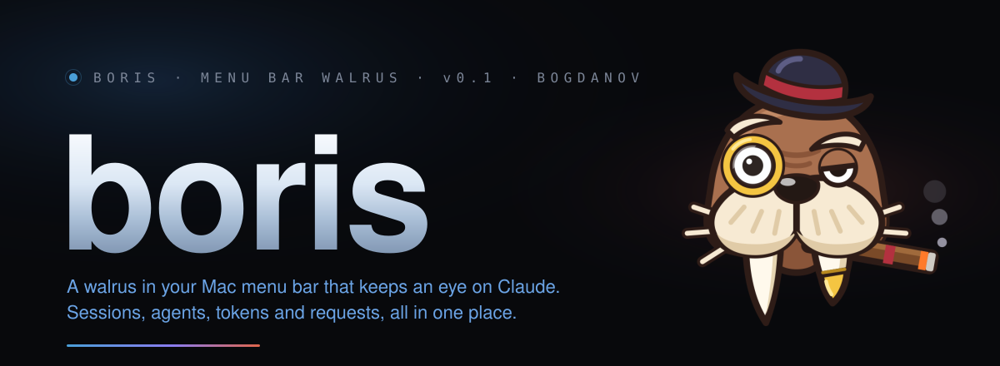
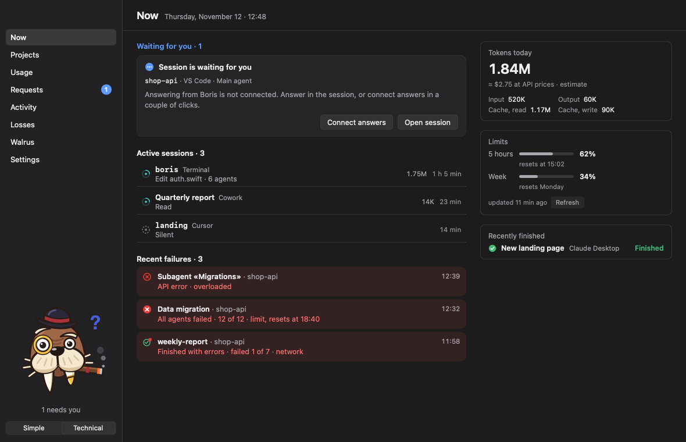
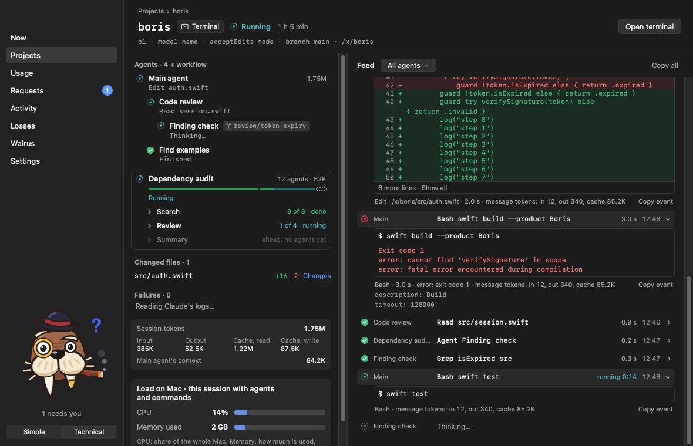
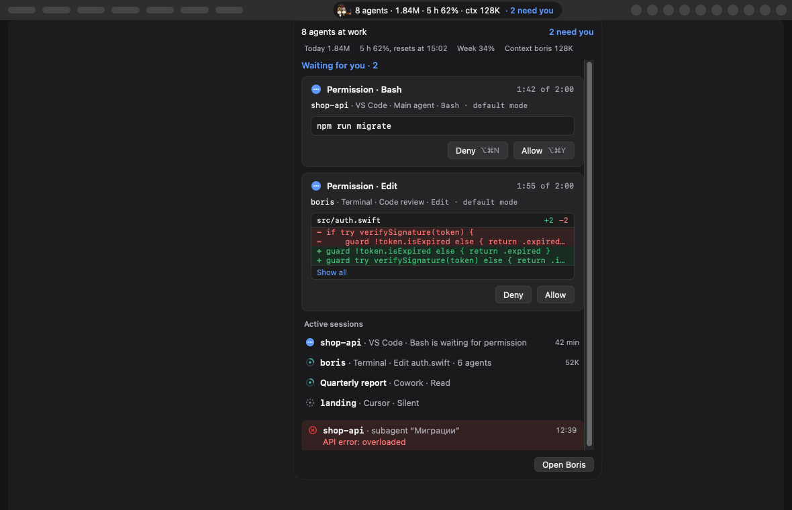
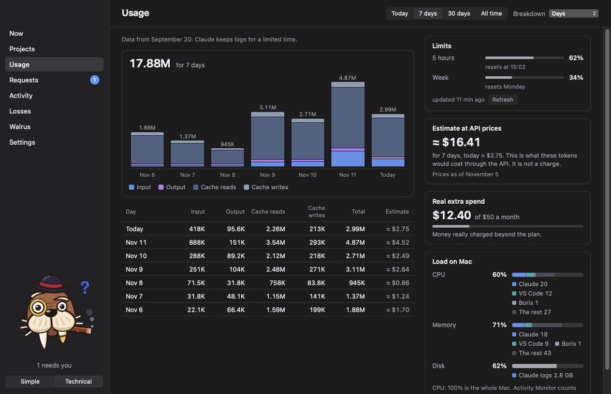
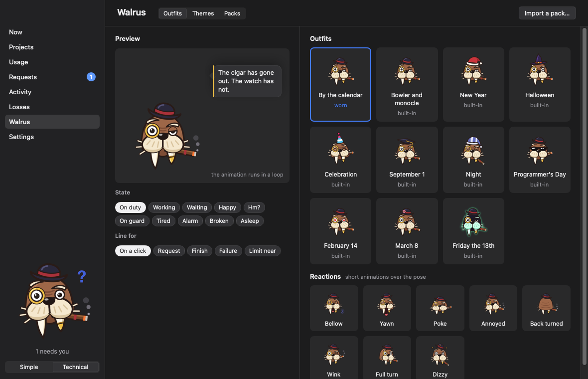

<p align="center">
  
</p>

<p align="center">
  
  
  
  
  
  
</p>

<p align="center">
  <a href="README.md">English</a> · <b>Русский</b>
</p>

---

Boris — небольшое приложение для Mac для тех, у кого Claude работает в нескольких местах сразу.

В терминале идёт одна сессия, в VS Code другая, где-то в фоне крутится workflow на десяток агентов, а Cowork собирает отчёт. Что из этого ещё работает? Что только что упало? Сколько осталось от недельного лимита? И кто уже десять минут ждёт, пока вы нажмёте «Разрешить»?

Boris отвечает на всё это одним взглядом. Он живёт в строке меню, носит котелок и монокль и молчит, пока вы не понадобитесь.

<p align="center">
  
</p>

## Что он умеет

**Видит всё, что запущено.** Claude Code в терминале, VS Code, Cursor и приложении Desktop, Cowork и другие машины через SSH. Проекты, сессии, каждый агент и субагент, workflow по шагам и то, чем каждый из них занят прямо сейчас.

<p align="center">
  
</p>

**Даёт ответить, не переключая окно.** Разрешения, вопросы и планы приходят карточками. Разрешить, отказать или объяснить причину можно прямо из строки меню, чёлки или маленького окна.

<p align="center">
  
</p>

**Считает расходы.** Токены по дням, проектам, моделям и агентам. Лимиты плана на 5 часов и на неделю и доплаты, за которые вы платите на самом деле. А ещё сколько процессора и памяти занимает Claude.

<p align="center">
  
</p>

**Объясняет, почему упало.** Workflow пишет `completed`, а все двенадцать его агентов упёрлись в лимит? Boris так и скажет и подскажет, когда лимит сбросится.

**Зовёт, когда это важно.** Уведомление Mac, звук или сообщение в Telegram, когда ждёт запрос или что-то упало.

**Два режима.** Простой, чтобы одним взглядом понять, нужны ли вы. Технический, чтобы видеть всё: ленты, правки, команды и разбивку токенов.

## Знакомьтесь, Борис

Морж в котелке, с моноклем и сигарой. Характером он в Черчилля: плохие новости сообщает с достоинством, даже когда всё горит. Одевается по случаю: на Новый год колпак Санты, на Хэллоуин ведьминская шляпа. Если его ткнуть, он отреагирует. А если хочется кого-то другого, его можно заменить своим персонажем из набора картинок.

<p align="center">
  
</p>

## Как установить

Готовых выпусков пока нет, Boris собирается из исходников. Нужны macOS 14 или новее и Xcode со Swift 6.

```sh
git clone https://github.com/bogdanov-igor/boris.git
cd boris
scripts/install.sh
```

Скрипт собирает приложение, кладёт его в `~/Applications/Boris.app` и запускает. Чтобы обновиться, запустите его снова после `git pull`. Без сертификата разработчика Apple сборка подписывается без него, и macOS может заново спрашивать разрешения после каждой сборки. Подписанные выпуски с автоматическими обновлениями появятся позже.

## Хуки необязательны

Без них Boris читает только файлы, которые Claude и так пишет на диск, и этого хватает почти на всё. Хуки добавляют две вещи: ответы на запросы прямо из Boris и мгновенные новости о событиях. Включаются они в настройках. Сначала Boris показывает, что именно изменится в настройках Claude, а при отключении убирает только то, что добавил сам.

## Данные остаются на вашем Mac

Ни аккаунта, ни сервера. Boris никуда не отправляет ваши промпты, команды и код. В интернет он ходит только за лимитами плана, а ещё в Telegram, если вы его включите. Настройки Claude он меняет, только когда вы сами подключаете хуки.

## Лицензия

Код под MIT. Морж, его рисунки, реплики и звуки — нет, подробности в [LICENSE](LICENSE).

Boris — независимый проект, он не связан с Anthropic.
